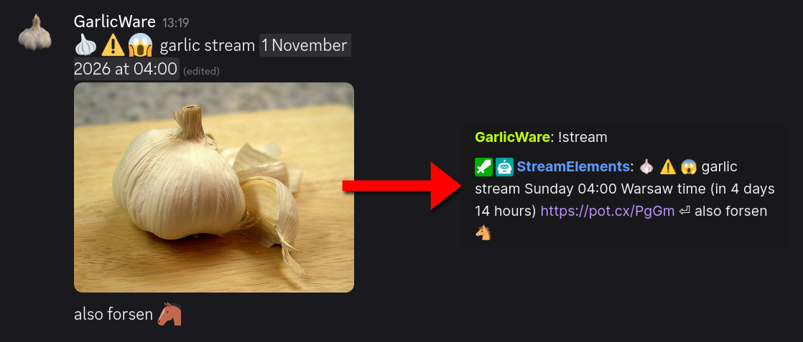

# dc2cmd

A Python program that copies the latest messages from a Discord channel into a StreamElements custom command.



## ❓ What it does

- Pulls the latest Discord channel messages with the Discord API.
- Cleans them up and joins them into one reply.
- If messages have changed, updates the StreamElements command using its API.

## 📋 Requirements

- Python 3.11 or newer

## ⚙️ Configuration

Copy `.env.example` to `.env` (or e.g. `.env.myconfig`) and fill in the values. Every setting is documented in the file. `--config` also accepts a path to a config file in any location.

## 🏃‍♂️‍➡️ Running

    python dc2cmd.py                             # loads .env
    python dc2cmd.py --config myconfig           # loads .env.myconfig
    python dc2cmd.py --config path/to/config     # loads that file
    python dc2cmd.py --config myconfig --debug   # loads .env.myconfig with detailed logging

The script creates a `.cache` directory with state and lookup files, one set per config profile. Run it on a schedule to keep the command up to date.

Example cron entry will run the program every minute:

```
* * * * * cd /home/user/dc2cmd && /usr/local/bin/python dc2cmd.py --config myconfig >> dc2cmd.log 2>&1
```

Add `--debug` to see verbose messages, recommended only for troubleshooting or manual runs.

## ✨ Features

- **Caching** - Only updates the StreamElements command when the Discord messages have changed.
- **Attachment link shortening** - Shortens Discord attachment links with [PotatBotat](https://potat.app/redirects) when possible and caches them. Discord changes attachment URLs a few times a day, so short links are recreated only when that happens.
- **Timestamps** - Automatically converts [Discord timestamp tags](https://r.3v.fi/discord-timestamps/) to readable dates and times, with a [countdown for future times](https://docs.streamelements.com/chatbot/variables/time).

## 🛠️ Development

The runtime has no dependencies. Install the development tools and run the checks with:

    python -m pip install -r requirements-dev.txt
    ruff format .
    ruff check .
    
    python -m unittest discover -s tests -v

GitHub Actions runs the tests on Python 3.11 and 3.14, and verifies formatting and linting on every push and pull request.

## 🔍 Troubleshooting

If the StreamElements command gets deleted and recreated, the cached command id becomes invalid. Delete the `*-se-ids.json` file from `.cache` (e.g. `.cache/myconfig-se-ids.json`) so it gets looked up again.

## ⚠️ Disclaimer

This software is provided as-is. The author is not responsible for any misuse of it or for any consequences that come from running it.

You are responsible for keeping your own credentials secure. That means your Discord and StreamElements tokens, your config files, and your `.cache` directory - don't commit them, share them, or leave them readable by others.

Please don't abuse third-party integrations. The tool talks to the Discord API, the StreamElements API, and a link shortener ([PotatBotat](https://potat.app/redirects)); respect their terms of service and rate limits, and don't use them to spam, flood, or otherwise degrade service for anyone else.

## ⚖️ License

This software is released under the terms of [WTFPL Version 2](LICENSE) license. Copyright 2026 GarlicWare.
